# Claude Folders Features

Every feature of Claude Folders, with screenshots. Installation and usage are in [README.md](README.md), and release notes in [CHANGELOG.md](CHANGELOG.md).

### Folder Management

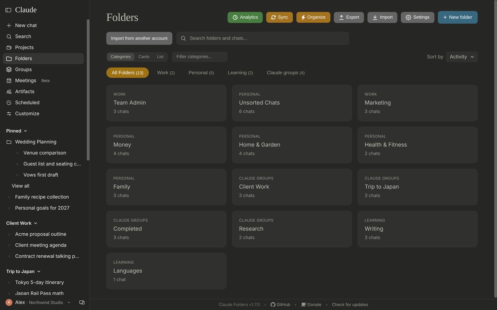

- Create unlimited folders with custom names
- Assign folders to categories. Personal, Work, and Projects exist from the start, and categories are added and removed with the pencil button in the popup
- Move chats between folders with drag-and-drop or menu
- Search and filter folders by name or category
- Category pills show each category's folder count, with empty categories last
- View chat count and last activity per folder
- Clicking **Add to folder** at the top of a chat page files the chat in a folder, or in a new one with **Create & Add**

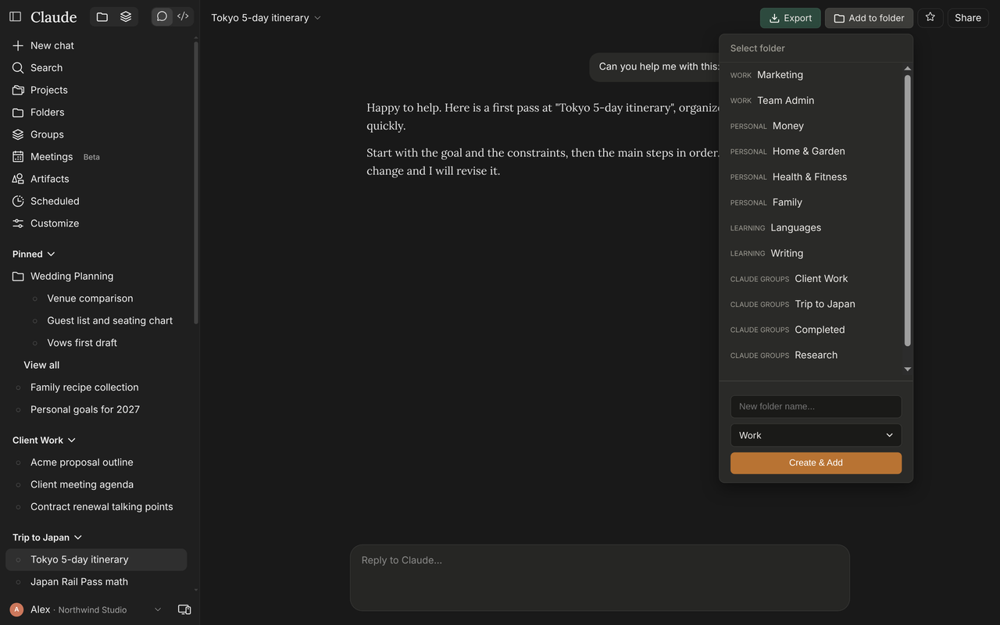

### Folders Sidebar Panel

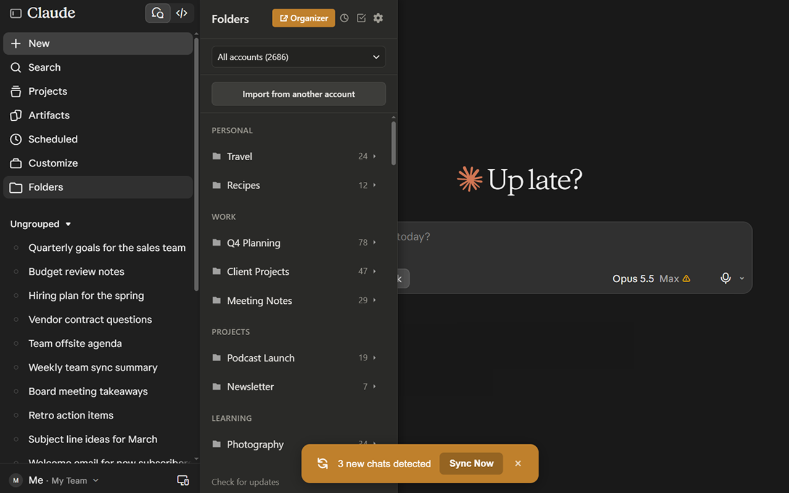

- Clicking **Folders** in Claude's sidebar, or the folder button in the sidebar header, opens the panel beside it
- Clicking **Folders** again or clicking outside the panel closes it. The Folders row is highlighted while the panel is open
- The square-check's choice to show or collapse the organize steps is kept, in the panel and the popup
- At the top are **Organize in One Click** and the 2 steps, **Ask Claude to Organize** and **Apply Claude's Response**. The square-check button shows and hides them
- The account dropdown is under them, with **Import from another account** below it while another account has chats
- The popup has the same account dropdown above its search box. The choice is stored once per login and is the same in the popup, the Folders panel and the organizer, and an open one follows a change made in another
- Clicking a folder opens its chats in a second pane to the right of the panel, with full titles, 30 at a time with **Load more**
- Clicking the folder again, the pane's **×** or pressing Escape closes the pane
- One of the Folders and Groups panels is open at a time

### Sidebar Header Buttons
- A folder button and a layers button are placed as a pair between the Claude logo and Claude's Chat and Code switch, built like that switch
- Clicking either one opens or closes its panel, and the button is highlighted while its panel is open
- **Folders and Groups buttons in Claude's sidebar header** on the settings page is checked by default

### Groups Sidebar Panel

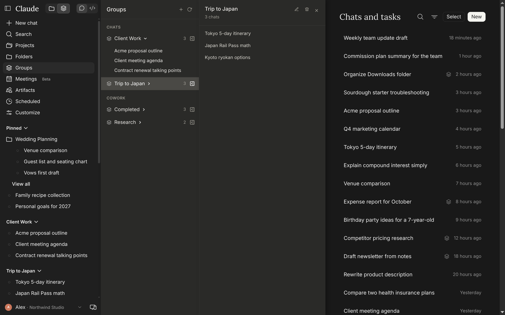

- Clicking **Groups** in Claude's sidebar, or the layers button in the sidebar header, opens the panel beside it, with Claude's sidebar groups under **Chats** and **Cowork** and each group's number of chats
- Clicking a group lists its chats under it, 30 at a time with **Load more**, and clicking it again hides them. The caret right after the group's name points down while its chats are listed
- The pane button at the right edge of a group's row opens its chats and sessions in a pane to the right of the panel, 30 at a time with **Load more**, and clicking it again closes the pane
- A group's chats are listed in the order of Claude's sidebar
- Clicking **+** creates a group: a Cowork group on a Cowork page, and a chats group on any other page
- In the pane, clicking the pencil renames the group, clicking the trash can deletes it after a confirmation, and clicking a chat's **×** takes it out of the group. A deleted group's chats stay in Claude, ungrouped
- Clicking the circular arrow reads the groups again
- Clicking the pane's **×** or anywhere outside the pane, or pressing Escape, closes the pane

### Claude Groups and Folders
- **Sync Claude groups with folders** in the Claude groups section of the settings page is checked by default
- Each group in Claude's sidebar has a folder of the same name in the **Claude groups** category
- A chat put in a group in Claude is placed in the group's folder, and is put back in its earlier folder when taken out of the group
- Moving a chat into or out of a group folder, renaming a group folder or deleting one changes the group in Claude the same way, through the next claude.ai tab in view
- Deleting a group in Claude turns its folder into an ordinary folder with its chats
- **Organize with Claude** does not move the chats of group folders
- After unchecking the setting, the group folders are unchanged, and edits in Claude's groups and in the folders are separate

### Dragging Chats

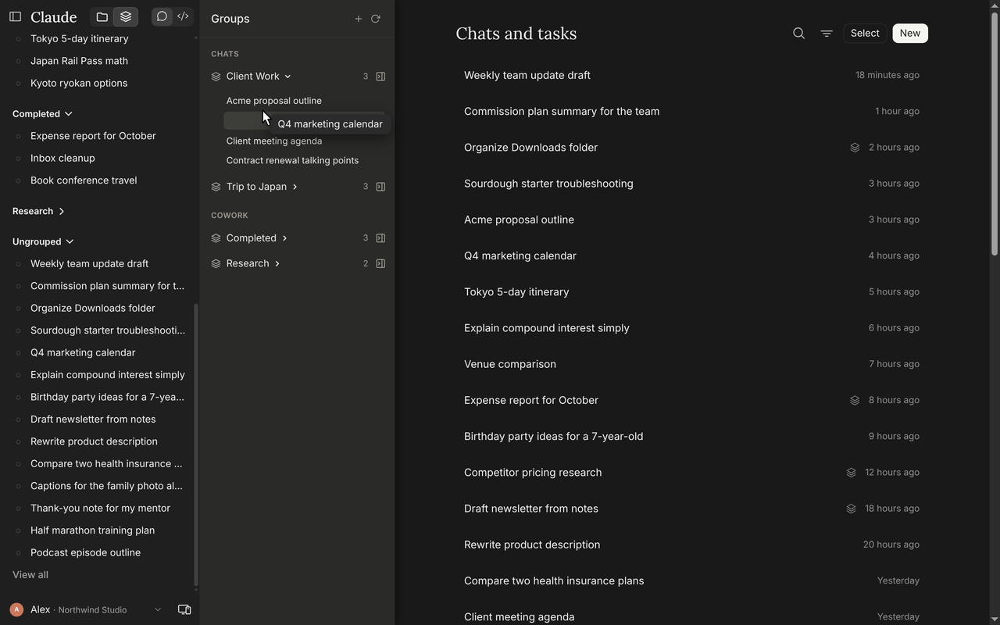

- Dragging a chat from Claude's sidebar or the Chats page onto a folder of the Folders panel, or that folder's open pane, puts it in that folder
- Dragging a chat from Claude's sidebar or the Chats page onto a group of the Groups panel, its expanded list or its open pane puts it in that group
- Releasing a drag anywhere leaves the open panel and pane open
- Holding a dragged chat on a closed group of the Groups panel for 0.7 seconds lists the group's chats
- Dropping a chat between 2 chats of a group's list or pane puts it at that place, shown by a gap during the drag. That order is saved in Claude's groups and shown in the Groups panel. Claude's sidebar shows it the next time claude.ai loads
- Dragging a chat of a group's list to another place in that list moves it there
- The image of a chat dragged from Claude's sidebar is drawn above the panels
- Dragging a chat from the Chats page onto a group's section in Claude's sidebar puts it in that group, and dragging one onto **Ungrouped** takes it out of its group. Dropping on **Pinned** does nothing
- Holding a dragged chat over the **Folders** or **Groups** row opens that panel
- On the Chats page, the open Folders or Groups panel and its pane move the chat list to their right

### Content Search
- Typing 2 or more characters in the organizer's search box lists the chats whose title has the typed text or whose export in `chats/` has every typed word
- Title matches are listed before export matches, newest first in each, 50 at a time
- A chat matched by its export shows an excerpt with the match marked. Clicking **View export** opens the export in a new tab
- The folder grid also shows the folders holding the listed chats
- On the first search, the words of every export are indexed in the browser, with the progress in the search status. Later searches index only new and changed exports
- **All**, **Titles** and **Content** at the top right of the chat list choose the chats listed: every match, title matches or export matches. **All** is chosen when the page opens
- The caret right of them collapses and expands the chat list
- A bar under the heading shows the search's progress while the exports are read, with the count of files in the status
- **Sort by** orders the chat list: **Best match** (title matches first, then the newest), **Name**, **Most recent message**, **Oldest message** or **Export date**. The button beside it switches between **Asc** and **Desc**. Chats with no value for the sort are listed last
- **Oldest message** needs the time each chat started. The first sync after 1.6.0 reads the whole conversation list once to record it for chats stored earlier
- The account dropdown limits the listed chats to the accounts it shows. The search reads every account's exports
- The title of another account's chat opens its export in a new tab. With no export, the title is plain text

### Organizer Views

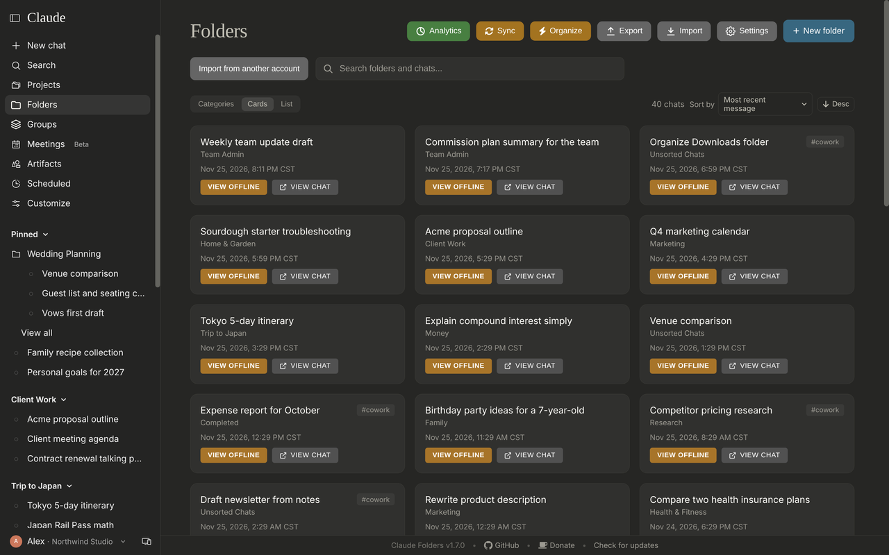

- **Categories**, **Cards** and **List** above the home page choose its view. **Categories** is shown until another view is chosen
- **List** and **Cards** show every chat of the folders the account dropdown shows, with each chat's folder, 100 at a time with **Show more**. The search box narrows them by chat title or folder name
- **Categories** shows the category pills, the category filter and the folder cards
- **Sort by** orders the chats of **List**, **Cards** and a folder's page: **Name**, **Most recent message**, **Oldest message** or **Export date**, with **Asc** and **Desc**
- A folder's page has the same search bar as the home, searching that folder's chats
- **View offline** appears on every chat whose export is in the data folder's `chats` folder, another account's chats included

### Update Check
- The popup, the Folders panel and the organizer show a notice when the version on GitHub is newer than the one installed, with **Open GitHub** and **×**. **×** hides the notice until a later version is published
- The version is read from the extension's `manifest.json` on GitHub at most every 6 hours. Clicking **Check for updates** in the popup, the Folders panel or the organizer's footer reads it without the 6-hour wait

### Organizer Sidebar
- The organizer's sidebar has the rows and sections of Claude's sidebar as last read on claude.ai: the rows with their icons and badges, **Pinned** with each project's newest chats, Claude's groups, and **Ungrouped**
- Clicking a section's name opens or closes it, with the caret after the name. The choice is saved for the next visit, and a section with no choice is drawn as it was on claude.ai
- **Folders** shows every folder. **Groups** is shown when Claude's groups have folders, and clicking it shows the **Claude groups** category
- The account button has the initial in the circle color of Claude's account button, then the name and the team on one line. Clicking the apps button beside it opens claude.ai/downloads
- The collapse button is before the name, as in Claude's sidebar, in the organizer, the settings page, and the offline library

### Organizer Top Bar
- **Folders**, **Analytics**, **Sync**, **Organize**, **Export**, **Import**, **Settings** and **+ New folder** are at the top of every organizer page: the folder list, a folder and the analytics
- Clicking **Folders** shows the folder list
- **Analytics** is shown pressed while the analytics page is open. Clicking it there returns to the folder list, the same as **Back to Folders**

### Organizing with Claude
Claude sorts your chat titles into categories and folders. The request is automatically inserted and sent in a claude.ai tab, and Claude's answer is read from that page.

- Clicking **Organize in One Click** in the Folders panel or the popup, or **Organize** in the organizer, opens a new claude.ai tab and sends the request with your chat titles
- Once Claude's answer is finished, the preview of its categories and folders is shown in that tab. Clicking **Apply & Save** files the chats, and nothing is saved before that click
- After 10 minutes without a finished answer, a notice with **Read the answer now** is shown
- After a reload of the tab while Claude answers, the preview is shown when that chat's answer is finished
- In 2 steps: clicking **Ask Claude to Organize** opens a new claude.ai tab with the request in the message box, for sending by hand. Pasting Claude's JSON answer into **Apply Claude's Response**, then clicking **Preview Categories** and **Apply & Save**, files the chats

### Markdown Export
- Export individual chats or bulk export all conversations
- Full conversation content including all messages and responses
- Automatic filename generation: `{first 8 characters of the chat id}_{title}.md`, and `{session id}_{title}.md` for Cowork and Claude Code sessions
- Each message has its date and time under its **Human** or **Claude** heading, such as `*Oct 30, 2026, 9:22 AM CDT*`, in the time zone of the browser that wrote the export
- Skip exports that are on disk and current (no duplicates)
- An export with no message timestamps, or older than the chat's newest change, is written again over its file by the next sync or folder export
- Exports stored in `/chats/` subfolder within your data directory

### Shared Chats
- Shared chats (`claude.ai/share/...`) show **Export** and **Import** at the top right
- Clicking **Export** saves the shared transcript to `chats/` in your data folder
- Clicking **Import** exports the transcript, starts a new chat with the file attached, and asks Claude to reconstruct the conversation
- In a project's **Activity** tab, a button appears above the chats others shared. It reads **Import N shared chats** when some are not imported yet, and clicking it imports them one at a time after a confirmation showing the count. With all of them imported it reads **Import shared chats** and offers to import them again
- Imported chats are filed under the **Shared** category in a folder named for their project
- Chats already imported are skipped, including imports made in another browser

### Cowork Sessions
- Cowork sessions (`claude.ai/cowork/...`) show **Export** and **Add to folder** beside the session title
- Clicking **Export** saves the whole session to `chats/`: your messages, Claude's replies, tool calls and tool results
- Syncing stores Cowork sessions in the folders beside your chats and exports the new ones. Their rows in the folders panel have a **Cowork** label

### Claude Code Sessions
- Claude Code sessions on the web (`claude.ai/code/session_...`) show **Export** and **Add to folder** beside the session title
- Syncing stores them in the folders beside your chats and exports the new ones. Their rows in the folders panel have a **Claude Code** label
- An export has each message with its date and time, and the session's `claude.ai/code` link. Thinking with text is a collapsed **Thinking** section, and the session's setup and status events are left out
- Claude Code and Cowork are read through the same session list. A session without the Cowork tag is a Claude Code session
- From another account, a Claude Code session's export is imported as a Cowork task, the same as a Cowork session's

### Moving Cowork Sessions to Another Account
- Export the sessions in the first account with **Export** or a sync
- In the other account, **Import from another account** in the Folders panel imports them as Cowork tasks (below)

### Importing Another Account's Chats
- Choose the same data folder in both accounts. Syncing the first account exports its chats to `chats/`
- In the second account, click **Import from another account** under the account dropdown in the Folders panel, or beside the account dropdown in the organizer. Clicking the organizer's button opens the dialog in a new claude.ai tab, and the import is run in that tab
- The dialog has the account to import from (**All other accounts** is the first choice with 2 or more), the account to import into, and the number of chats and Cowork tasks to import, with the ones skipped as imported before or with no export
- **Request sent with each chat**: **Short** (Claude replies with one line), chosen until it is changed, or **Reconstruct** (Claude replies with a summary of the chat). The choice is saved to the settings page
- **Pause after each batch of 25 chats** is unchecked, and the import is run to the end with no pause. Checking it pauses the import after each batch, with the batch size from 1 to 500
- Clicking **Import N** starts the import. Each chat is started as a new chat with its export attached, and each Cowork session as a Cowork task, one at a time
- Clicking **Pause** or **Stop** on the progress bar pauses or ends the import after the chat in progress. A paused import shows **Resume** and **Stop**
- The popup and the organizer show the import's progress and result
- Each import is filed in this account's folder with the same name and category, or in a new folder of that name
- Clicking **Import from another account** again skips the chats already imported

### Accounts
- Each Claude login has its own folders and its own data file, `data.<account>.json`, in the data folder
- Every organized chat records the account it belongs to, and each account's data file records the account's email and name
- With chats from more than one account, or more than one organization, the Folders panel and the organizer have an account dropdown: **All accounts**, then each account by email with its chat count, and under an account with more than one organization, each organization
- **All accounts** shows the folders of every account in the data folder together, merged by folder name. Chats of another account show its email and open in a browser signed in to that account
- Each signed-in login has its own dropdown choice. The settings page sets what a login without a choice shows
- After a sync, chats held in another account's data are listed only under that account
- A sync gives chats stored without their organization the organization they belong to

### Automatic Sync
- On every 1 hour after install. **Sync automatically** in the Automatic sync section of the settings page's Settings tab turns it off and on
- **Hide the new chats notice on claude.ai while automatic sync is on** is checked by default
- **Every** sets the interval: 15 minutes, 30 minutes, 1 hour, 2 hours or 4 hours
- Each sync runs in an open claude.ai tab with a writable data folder. A turn with no claude.ai tab open is skipped, and no tab is opened for it
- No folder prompt and no result window appear for an automatic sync. A notice appears on claude.ai when it added, exported or updated chats
- The section shows the time and result of the last automatic sync

### Popup Sync Icon

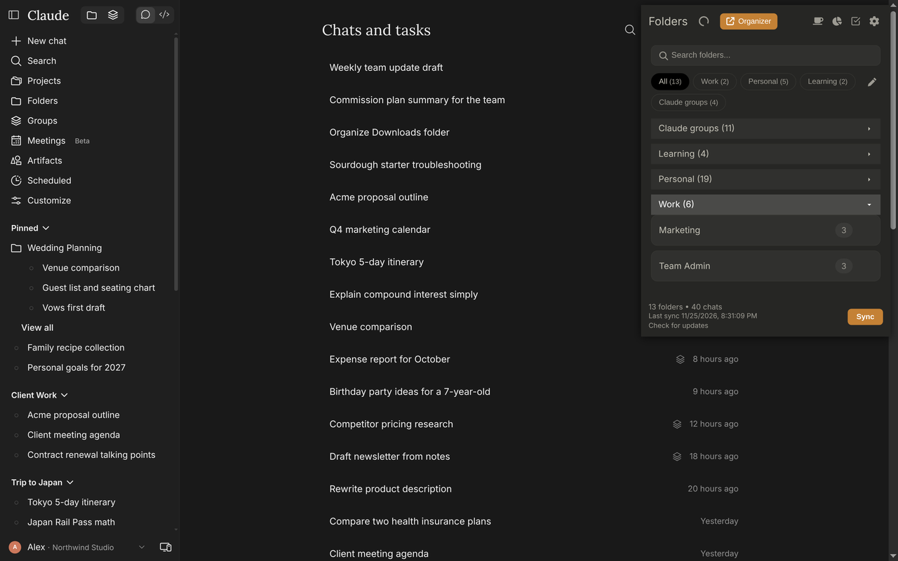

- The half ring between the Folders title and the Organizer button in the popup is orange while chats are waiting: new chats, chats with a newer message than their export, or exports in an older or unrecorded format. It has the other icons' color when nothing is waiting
- Clicking it while orange starts a sync. Clicking it with nothing waiting opens **Everything is up to date** with **Force resync**, which reads the whole conversation list and writes every export again over the same files

### Sync Progress Bar
- During a sync, the bar on claude.ai has **Pause** and **Stop**. Both take effect before the next chat is exported
- A paused sync shows **Resume** and **Stop**. After **Stop**, the bar shows the counts so far with **Start** for a new sync
- Clicking **×** hides the bar. The sync is still running, and the popup and the organizer show its progress
- The sync runs in its claude.ai tab. Closing or reloading the tab ends it, and the next sync exports the chats not yet exported

### Settings Page

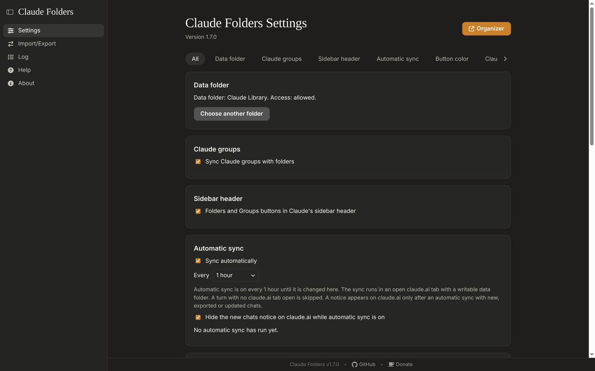

- Opened from the browser's Extension options, the gear button in the popup and the Folders panel, or **Settings** in the organizer
- A sidebar on the left has **Settings**, **Import/Export**, **Log**, **Help** and **About**, with the organizer's collapse button, drag edge and row colors. The page opens on **Help** once after the extension is installed, and on **Settings** after that
- A row of chips above the first section filters the open tab: **All** shows every section and is chosen when a tab opens, and a section's chip shows that section alone. The row scrolls left and right when it is wider than the page
- **Organizer** at the right of the title opens the organizer
- The footer has the version, **GitHub** and **Donate**, as in the organizer
- **About**: what Claude Folders is, **Donate**, the version section and the attribution with the GitHub link
- **Import/Export**: **Export settings** and **Import settings** for `claude-folders-settings.json`, **Export chat list** and **Import organized folders** for Claude's organizing, and the **Import from another account** section with **Open import dialog**
- **Log**: syncs, exports, imports, folder changes, folder access and settings changes since the extension was installed, newest first, with **Clear log**. **Per page** shows 20, 50, 100, 250, 1,000 or all entries, with **Newest**, **Newer**, **Older** and **Oldest** under the list, and the last 50,000 entries are kept. The chips above the log show each kind of entry with its count (Sync, Auto sync, Exports, Imports, Folders, Folder access, Colors, Accounts, Organizer, Extension), and checking one or more shows only those kinds
- **Help**: the setup steps and the main features, with dark screenshots, buttons that do each step from the page, and a line under each setup step showing whether it is done
- The **Settings** tab starts with **Data folder**, then **Claude groups**, **Automatic sync**, **Button color** and **Claude Folders Helper**
- **Button color**: the color of the orange buttons on claude.ai and in the popup, chosen from six preset circles (the default orange first) or the **Custom color** square on the line under them, with a sample button and **Reset**. Every other orange of the extension is a CSS relative color of the chosen one, with the OKLCH lightness offset it has from the default orange and the chosen color's hue (`lib/color-variants.css`). **Apply to the organizer**, unchecked until checked, lets the organizer and its chat view follow the color too. Hovering a button shows a lighter shade of the chosen color, and open claude.ai tabs and popups change as soon as it is saved
- **Data folder**: the folder and whether the folder writer can save into it, with the buttons that state needs. **Choose folder** is the main button without a folder or with a folder Chrome did not answer for, **Allow access** appears for a folder without access, and **Choose another folder** appears with a chosen folder. The popup's folder buttons and the claude.ai folder notices open this section
- **Claude groups**: **Sync Claude groups with folders**, checked by default
- **Accounts**: each account with its chats, folders and organizations, and every account data file in the data folder
- **Folders panel**: whether a login opens on its own folders or on all accounts
- **Import from another account**, on the Import/Export tab: the request sent with each imported chat, a short request or a full reconstruction. A choice made in the import dialog is saved here
- **Claude Folders Helper**: what the helper does, **GitHub releases** for its download, and whether it is installed and finds the data folder, with **Check again**
- **Clear folder data**: clicking **Clear folders** and confirming empties this login's folders. Other accounts' data files are left as they are

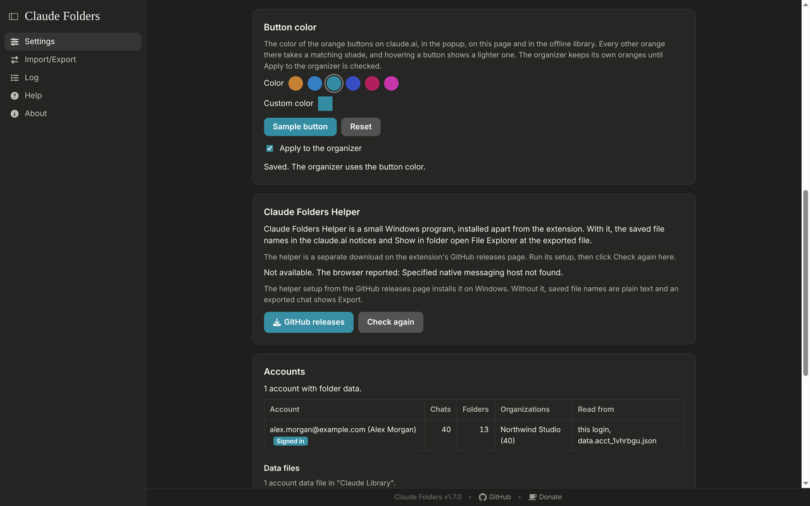

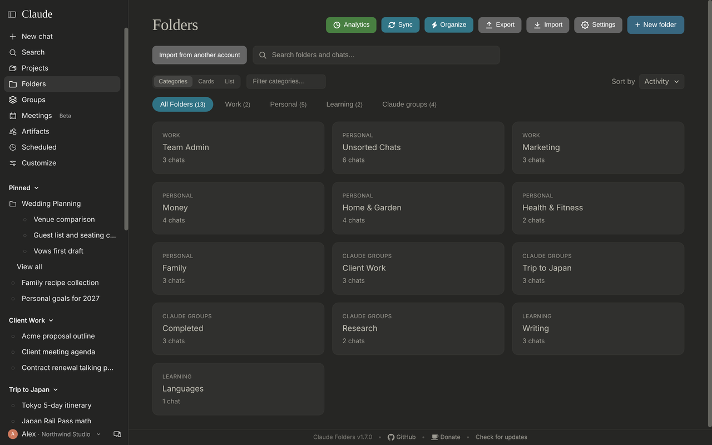

### Saved Files and Show in Folder
- After a single export, the Saved notice stays open until its **×** is clicked
- An exported chat, Cowork session or Claude Code session with messages newer than its export, or with an export that has no message timestamps, shows **Export Update**, which writes over the same file, and hovering over it explains this
- Every sync exports the stored chats, Cowork sessions and Claude Code sessions missing from the data folder, and writes the outdated exports again over their files
- Chrome extensions cannot open File Explorer. On Windows, the Claude Folders Helper does it. Its setup is a separate download on the [GitHub releases page](https://github.com/lso2/claude-folders/releases). With the helper installed, the file name in the Saved notice is underlined and an exported, current chat shows **Show in folder**. Clicking either opens File Explorer with the file selected
- Without the helper, the Saved notice shows the file name as plain text, and an exported, current chat shows **Export**, which writes over the same file

### Offline Viewing

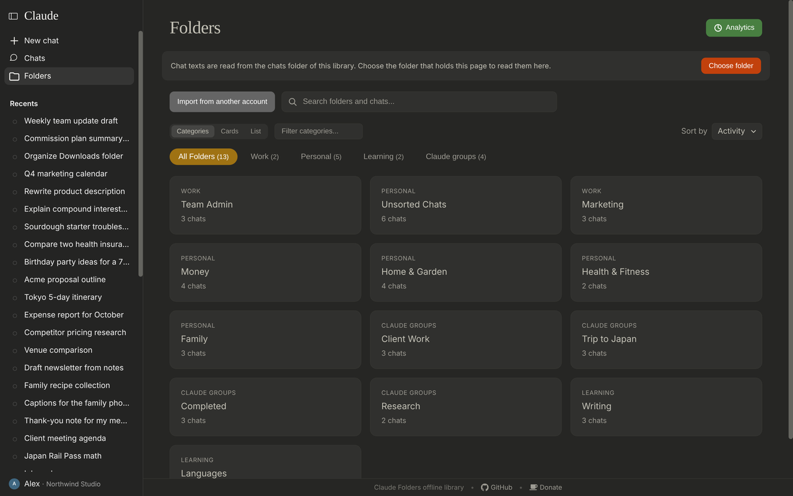

- Click "View Offline" to read any exported chat. It opens in its own tab, `organizer/export-view.html` from the organizer and `view.html` from the library, and reloading the tab shows the chat again
- Styled HTML viewer with proper markdown rendering
- Code syntax highlighting
- Works completely offline after export
- The library page, `index.html` in the data folder, shows each chat's text from `chats/`. Opened from disk, the page needs the data folder chosen once (**Choose folder**) and reading allowed on later visits (**Allow reading**)
- New exports appear in the library with no rebuild step
- The library's page and files in the data folder are written again on every save and after the extension is updated or reloaded
- The library has the organizer's views and controls: **Categories**, **Cards** and **List**, **Filter categories**, the category pills with their counts, **Sort by** with **Asc** and **Desc**, folder pages with their **Activity** tab, the search of titles and exported text with **All**, **Titles** and **Content**, **Analytics**, and the sidebar's collapse button and drag edge
- The library's account dropdown lists the login of data.js and every account data file in the data folder once reading the folder is allowed, and opens on **All accounts**
- Sync, Organize, Export, Import, Settings, New folder and Import from another account need the extension and are in the organizer only

### Passive Chat Monitor
- Automatically detects new conversations, Cowork sessions and Claude Code sessions in the sidebar
- Shows a sync bar as soon as a new chat is available, with **Sync Now** and, when the data folder cannot be saved into, the reason with **Choose data folder** or **Allow folder access**
- The sync bar is hidden while automatic sync is on, until **Hide the new chats notice on claude.ai while automatic sync is on** is unchecked
- One-click sync to import all new chats
- Importing skips chats already in folders

### Chat Dates in the Organizer
- Chat rows show the date and time of the chat's last change, such as `Oct 30, 2026, 9:22 AM CDT`

### Analytics Dashboard

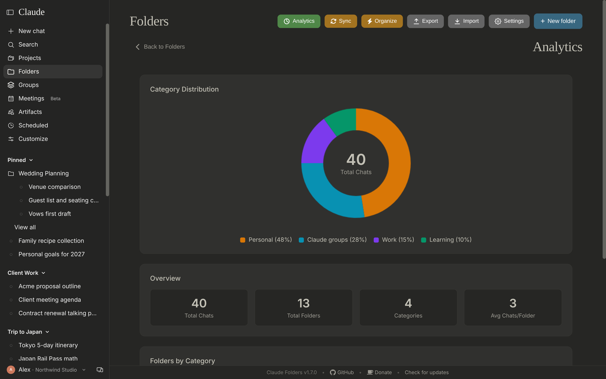

- Donut chart showing category distribution
- Total chats, folders, and categories overview
- Breakdown of folders by category
