# Claude Folders


A Chrome extension that adds folder organization, markdown export, and offline viewing to Claude.ai conversations. All data stays on your computer. There is no cloud sync and no account to create.

See [CHANGELOG.md](CHANGELOG.md) for release notes.

## Download

[](https://github.com/lso2/claude-folders/releases/latest)

Download the [Installer](https://github.com/lso2/claude-folders/releases) or the [Extension](https://chromewebstore.google.com/detail/claude-folders/hengfknofpmkamehkhkhlpifigeamlpm).

[](https://github.com/lso2/claude-folders/releases) [](https://chromewebstore.google.com/detail/claude-folders/hengfknofpmkamehkhkhlpifigeamlpm)


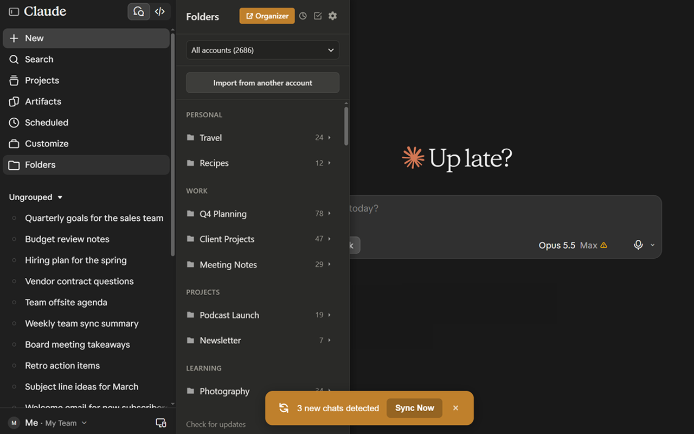

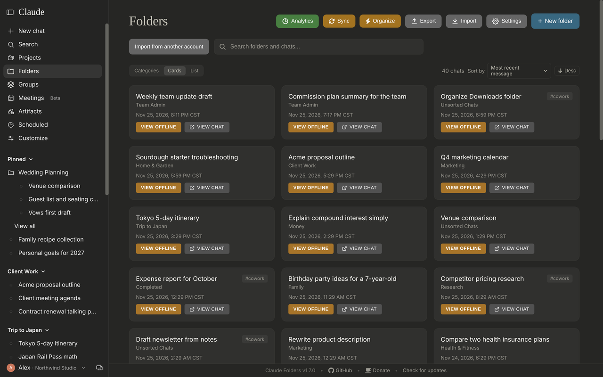

## Summary

Claude Folders transforms Claude.ai's flat conversation list into an organized folder system with:

- **Folder Organization**: Create folders, assign categories, organize hundreds of chats
- **Groups Integration**: Open the Groups panel to drag and drop into the panel with full Claude integration
- **Organize in One Click**: Chat titles are sent to Claude and step 2 runs automatically
- **Content Search**: The organizer's search matches both the titles and text of exported chats
- **Markdown Export**: Automatically export conversations to `.md` files with full content
- **Offline Viewing**: Read your exported conversations without internet access
- **Automatic Sync**: A sync is run in an open claude.ai tab every hour by default, at an interval of 15 minutes to 4 hours set on the settings page
- **Passive Sync**: A sync bar appears on claude.ai when a new chat is ready to import. While automatic sync is on, the bar is hidden unless **Hide the new chats notice on claude.ai while automatic sync is on** is unchecked
- **Shared Chat Import**: Chats shared with you are imported as new chats in your account, with the transcript attached
- **Cowork Sessions**: Cowork sessions are synced into folders and exported to markdown. Exports from another account are imported as Cowork tasks
- **Claude Code Sessions**: Claude Code sessions on the web are synced into folders and exported to markdown
- **Account Import**: Another account's chats and Cowork sessions can be imported into matching folders from the Folders panel or the organizer, with Pause, Resume and Stop
- **Full Account Import**: Reads every organization connected to your login
- **Drag and Drop**: Chats on the Chats page or in Claude's sidebar can be dragged onto a folder or a group
- **Analytics**: View category distribution and folder statistics
- **Local Storage**: All data stored in a folder you choose on your computer
- **Native Feel**: UI integrates seamlessly with Claude.ai's design

## Walkthrough Video

View the walkthrough video on YouTube:
[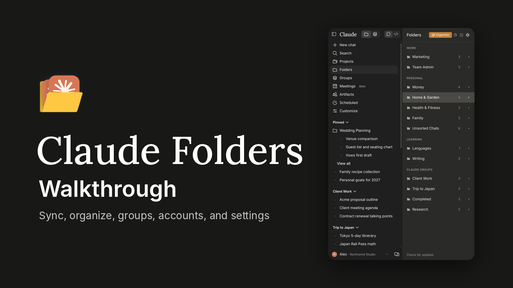](https://www.youtube.com/watch?v=umt1fUmrreM)

## Contents

<details>
<summary><a href="#installation">Installation</a></summary>

- [Step 1: Download Extension](#step-1-download-extension)
- [Step 2: Load in Chrome](#step-2-load-in-chrome)
- [Step 3: Choose the Data Folder](#step-3-choose-the-data-folder)
- [Step 4: Import Your Chats](#step-4-import-your-chats)

</details>

<details>
<summary><a href="#usage">Usage</a></summary>

- [Organizing Chats](#organizing-chats)
- [Folders Panel](#folders-panel)
- [Organize in One Click](#organize-in-one-click)
- [Organizer Views](#organizer-views)
- [Creating Folders](#creating-folders)
- [Using Groups](#using-groups)
- [Toolbar Popup](#toolbar-popup)
- [Sync and Export](#sync-and-export)
- [Syncing New Chats](#syncing-new-chats)
- [Accounts and Import from Another Account](#accounts-and-import-from-another-account)
- [Offline Library](#offline-library)
- [Analytics](#analytics)
- [Settings](#settings)
- [Button Color](#button-color)

</details>

<details>
<summary><a href="#data-storage">Data Storage</a></summary>

- [Privacy & Security](#privacy--security)

</details>

<details>
<summary><a href="#file-format">File Format</a></summary>

- [data.json](#datajson)
- [Exported Markdown](#exported-markdown)

</details>

[Browser Compatibility](#browser-compatibility)

<details>
<summary><a href="#troubleshooting">Troubleshooting</a></summary>

- [Extension won't load](#extension-wont-load)
- [Can't select data folder](#cant-select-data-folder)
- [Chats not syncing](#chats-not-syncing)
- [Sync does not start after the extension was reloaded or added again](#sync-does-not-start-after-the-extension-was-reloaded-or-added-again)
- [Folder access on every visit](#folder-access-on-every-visit)
- [The data folder was not read](#the-data-folder-was-not-read)
- [Failed chats in a sync result](#failed-chats-in-a-sync-result)
- [Export says folder access is needed](#export-says-folder-access-is-needed)
- [Brave: no data folder can be selected](#brave-no-data-folder-can-be-selected)
- [Export showing "empty chats"](#export-showing-empty-chats)
- [Offline view shows "File not found"](#offline-view-shows-file-not-found)

</details>

[Development](#development) · [Contributing](#contributing) · [Author](#author) · [License](#license) · [Support This Project](#support-this-project)

## Installation

With the extension installed from the [Chrome Web Store](https://chromewebstore.google.com/detail/claude-folders/hengfknofpmkamehkhkhlpifigeamlpm), start at Step 3.

### Step 1: Download Extension

```bash
git clone https://github.com/lso2/claude-folders.git
```

Or download and extract the ZIP file.

### Step 2: Load in Chrome

1. Open Chrome and navigate to `chrome://extensions/`
2. Enable **Developer mode** (toggle in top-right corner)
3. Click **Load unpacked**
4. Select the cloned or extracted folder, the one with `manifest.json`
5. The extension icon (folder) appears in your toolbar

### Step 3: Choose the Data Folder

1. After install the settings page opens on its Help tab. Click **Choose folder** in Step 1, then choose or create a folder on your computer (e.g., `Documents/Claude-Data`)
2. Click **Allow** in Chrome's prompt. Saving works while a Claude Folders page is open
3. After the next browser start, click **Allow access** in Step 1 or in the Data folder section of the Settings tab, and choose **Allow on every visit** in Chrome's prompt. Saving then works with every Claude Folders page closed
4. The extension icon's **Choose data folder** and **Allow folder access** buttons open the same section

### Step 4: Import Your Chats

1. Click the extension icon
2. Click **Sync** at the bottom of the popup
3. The sync is run in the active claude.ai tab, else in another open claude.ai tab, else in a new claude.ai tab. The popup shows its progress and result
4. Click **Organizer** to view and organize your chats

## Usage

### Organizing Chats

**From Claude.ai:**

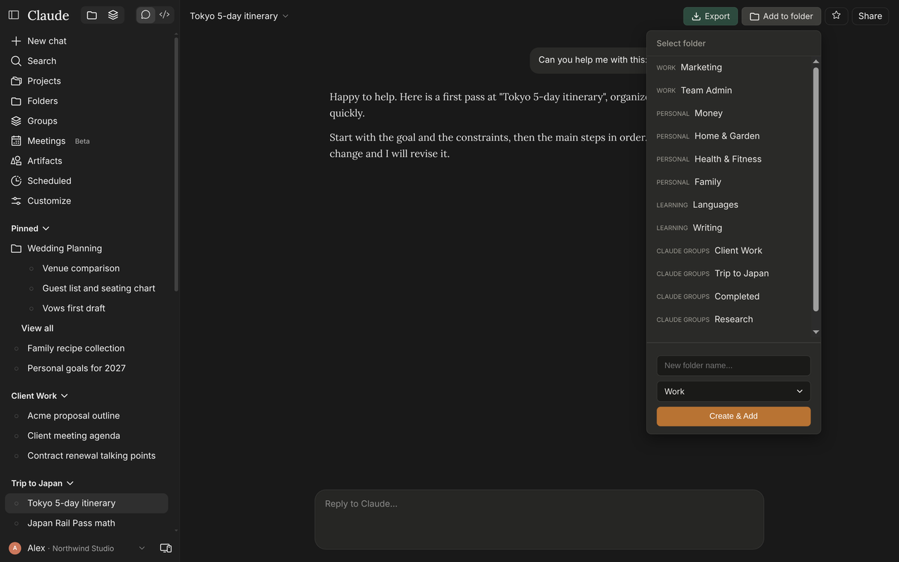

- On a chat page, click **Add to folder** at the top
- Click a folder, or enter a new folder's name and category and click **Create & Add**
- Chats can also be dragged from the Chats page or Claude's sidebar onto a folder in the Folders panel

**Organizer:**

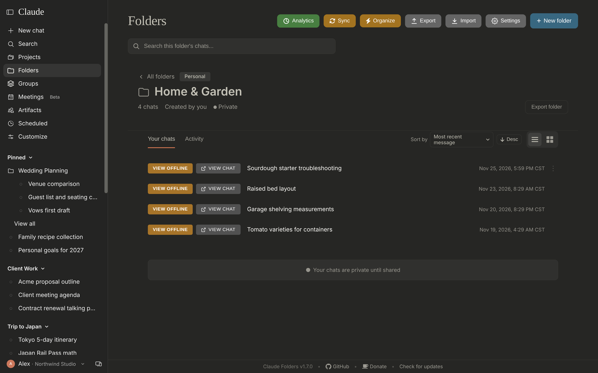

1. Click the extension icon, then **Organizer**
2. Click any folder to view its chats
3. Use the search bar to find folders, and chats by title or exported text
4. Click **View Chat** to open in Claude.ai
5. Click **View Offline** to read the markdown export
6. Click **Download** to save the markdown file

### Folders Panel

- Click **Folders** in Claude's sidebar, or the folder button in the sidebar header, to open the panel beside the sidebar
- Click a folder to list its chats in a pane beside the panel, 30 at a time with **Load more**
- **Organize in One Click** and its 2 steps are at the top of the panel. The square-check button shows and hides them

### Organize in One Click

1. Click **Organize in One Click** in the Folders panel or the popup, or **Organize** in the organizer
2. Your chat titles are sent to Claude in a new claude.ai tab, and Claude answers with categories and folders
3. Check the preview in that tab, then click **Apply & Save**. Nothing is saved before that click
- Chats in the folders of Claude's groups are not moved

### Organizer Views

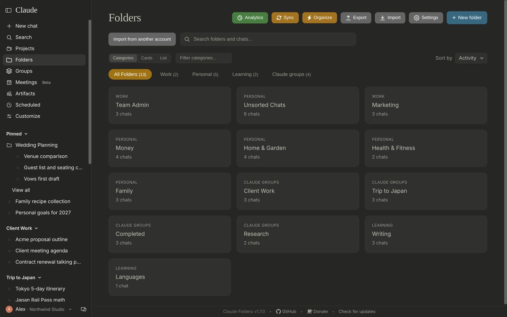

- Switch the home page between **Categories**, **Cards**, and **List**
- Click a category pill to show that category's folders. Each pill has its folder count
- Type in **Filter categories** to narrow the category pills
- Sort the chats with **Sort by**: name, most recent message, oldest message, or export date

### Creating Folders

1. Open the Organizer
2. Click **+ New folder**
3. Enter folder name and select a category
4. Click Create

### Using Groups

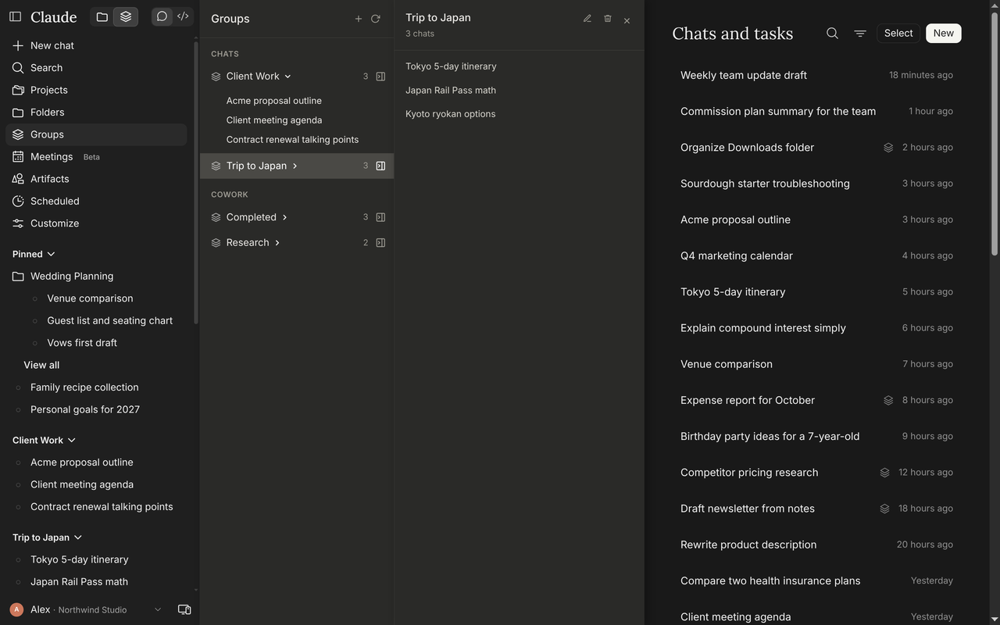

1. Click **Groups** in Claude's sidebar, or the layers button in the sidebar header
2. Click a group to list its chats, or the pane button at the right of its row to open them in a pane
3. Drag any chat from the Chats page or Claude's sidebar into its group

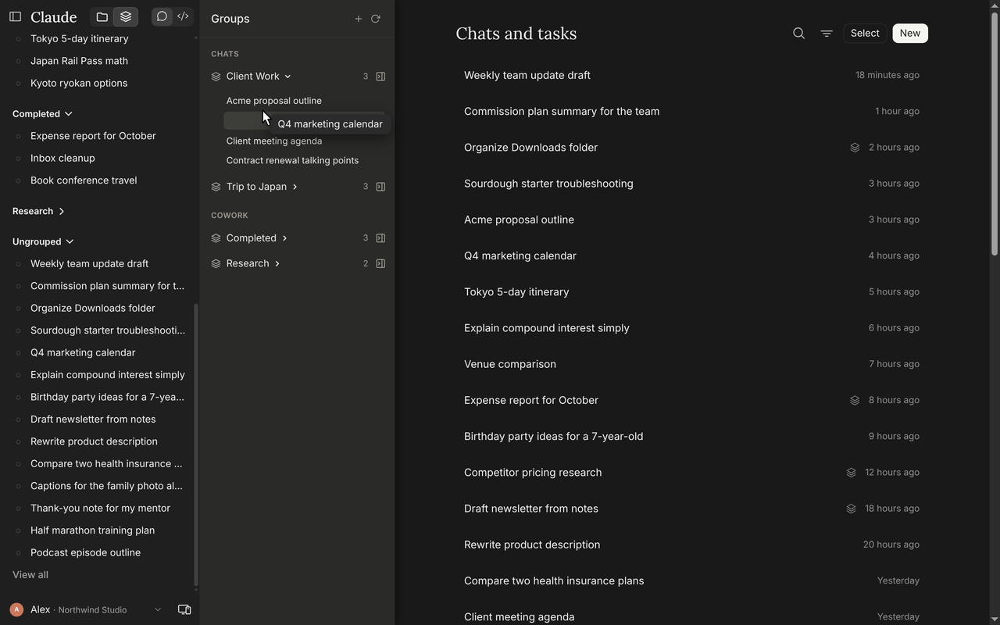

- Holding a chat over a closed group opens the group, and dropping the chat between 2 chats places it there
- Each Claude group has a folder of the same name in the **Claude groups** category. Changing one changes the other while **Sync Claude groups with folders** is checked on the settings page

### Toolbar Popup

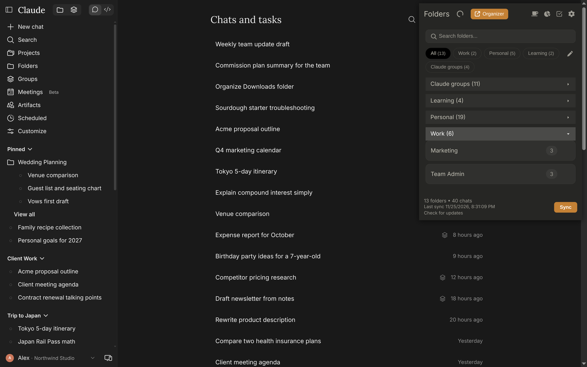

- Click the extension icon to open the popup, with your folders by category
- Click a category to list its folders, and a folder to open it in the organizer
- Search folders by name or by the chats in them
- The half ring beside the Folders title is orange while chats are waiting to sync. Clicking it starts the sync
- Click **Organizer** for the organizer, or the gear for the settings page

### Sync and Export

**All chats, from the popup or the organizer:**
1. Click **Sync**
2. Every chat, Cowork session and Claude Code session of this login is read. The ones missing from `chats/` are exported, and outdated exports are written again over their files
3. The popup and the organizer show the progress and the result, with the counts of imported, exported and updated chats
4. In the organizer, clicking **Download** saves the files written by that sync as one combined markdown file

**One folder, from the organizer:**
1. Open a folder this login created
2. Click **Export folder**
3. The folder's chats are saved to `chats/`, and the result appears at the top of the organizer

### Syncing New Chats

**Automatic sync:**
- Every hour, a sync is run in an open claude.ai tab. A turn with no claude.ai tab open is skipped
- Turn it off and on with **Sync automatically**, and set the interval with **Every**: 15 minutes, 30 minutes, 1 hour, 2 hours, or 4 hours. Both are in the Automatic sync section of the settings page

**New chats bar:**
- An orange bar appears on claude.ai once a new chat is detected in Claude's sidebar
- While automatic sync is on, the bar is hidden unless **Hide the new chats notice on claude.ai while automatic sync is on** is unchecked
- Click **Sync Now** to import
- Syncing needs a writable data folder. Without one the bar shows the folder state with **Choose data folder** or **Allow folder access**, which open the Data folder section of the settings page

**Manual:**
- Click **Sync** in the popup or the organizer, or **Sync Now** on the sync bar

### Accounts and Import from Another Account

- Each Claude login has its own folders, in its own `data.<account>.json` in the same data folder
- The account dropdown in the Folders panel, the popup, and the organizer shows **All accounts** or one account
- Click **Import from another account** under the account dropdown to start that account's chats as new chats in this one, each with its export attached. The progress bar has **Pause**, **Resume**, and **Stop**
- The imported chats are filed in folders of the same names, or in new folders of those names

### Offline Library

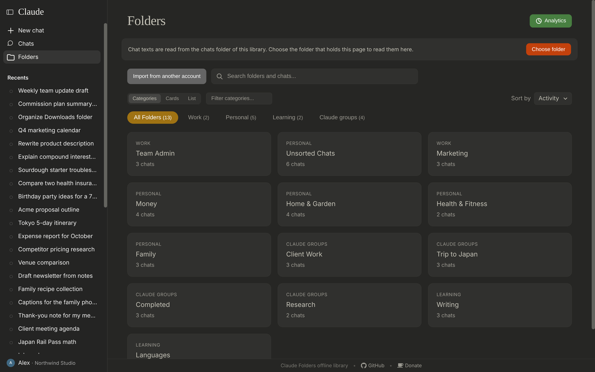

- Open `index.html` in the data folder for a library of your folders and exported chats, with no extension needed
- On the first visit, click **Choose folder** and pick the data folder. On later visits, click **Allow reading**
- In the organizer, click **View Offline** on a chat to read its export in its own tab

### Analytics

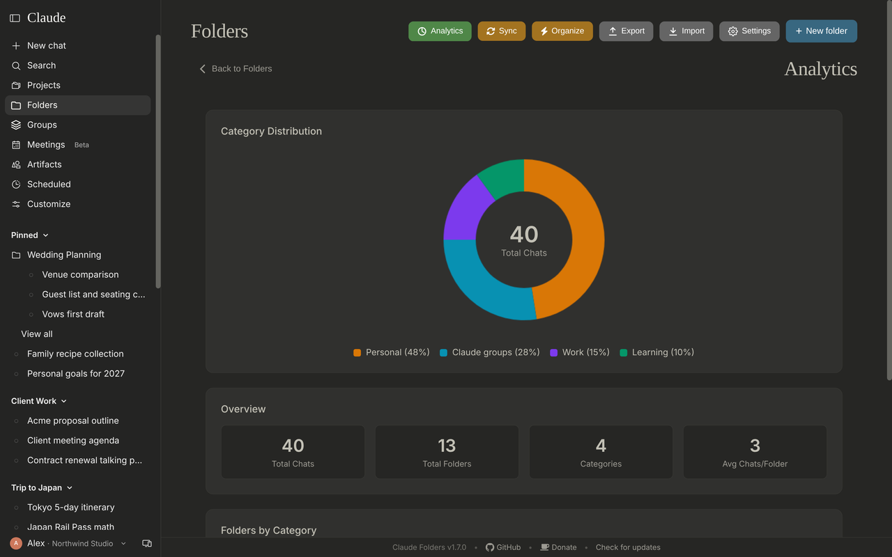

- Click **Analytics** in the organizer for a chart of your chats by category, the totals of chats, folders, and categories, and the folders of each category

### Settings

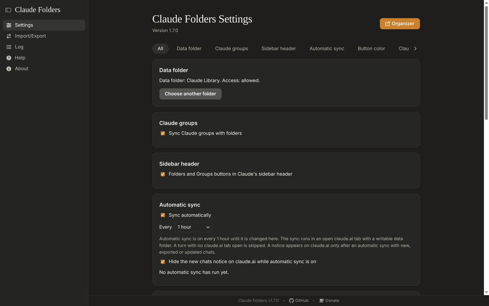

- Open the settings page with the gear in the popup or the Folders panel, or **Settings** in the organizer
- **Settings**: Data folder, Claude groups, Sidebar header, Automatic sync, Button color, Claude Folders Helper, Accounts, and Clear folder data
- **Import/Export**: the settings file, the folder lists for Claude, and Import from another account
- **Log**: every sync, export, import, folder change, and settings change, filtered by kind
- **Help**: the setup steps, with a button for each step
- **About**: the version, the GitHub link, and **Donate**

### Button Color

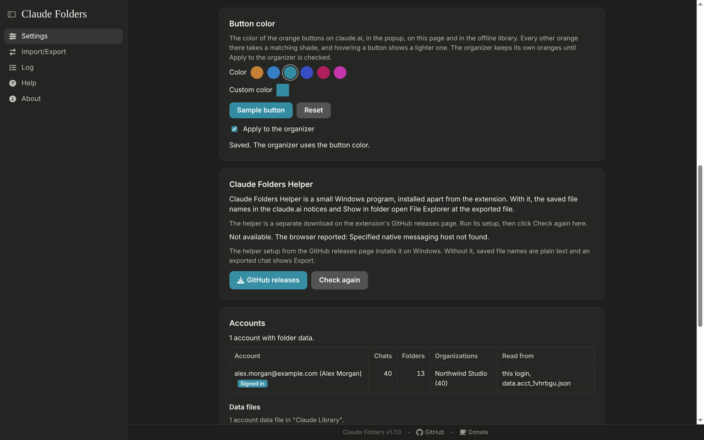

1. On the settings page, open **Button color**
2. Pick one of the 6 colors, or a custom color, for the orange buttons on claude.ai and in the popup
3. Check **Apply to the organizer** to use the color in the organizer and its chat view too. Click **Reset** for the default orange

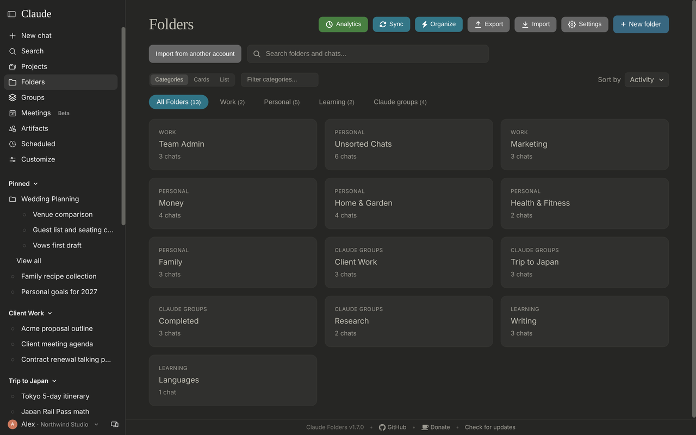

## Data Storage

All data is stored locally in the folder you selected:

```
Your-Data-Folder/
├── data.json            # Active account's folder definitions and chat assignments
├── data.<account>.json  # One file per Claude login, so accounts sharing a folder stay separate
├── data.js              # Same data for the standalone offline viewer
├── index.html           # Offline library page, with app.js, styles.css, chat-markdown.js, library-files.js and html-escape.js
├── view.html            # One chat of the library, with view.js, export-render.js, export-page.js and export-page.css
├── chats/               # Exported markdown files
│   ├── a1b2c3d4_Chat_Title_Here.md
│   ├── e5f6g7h8_Another_Chat.md
│   └── ...
```

### Privacy & Security

- **No cloud sync**: All data stays on your computer
- **No accounts**: No login or registration required
- **No telemetry**: The only request outside claude.ai is the update check. It reads the extension's manifest.json on GitHub, at most every 6 hours and on **Check for updates**
- **Portable**: Copy your data folder to any computer
- **Readable format**: JSON and Markdown files you can open anywhere

## File Format

### data.json
```json
{
  "categories": ["Personal", "Work", "Projects", "Claude groups"],
  "folders": [
    {
      "id": "folder-1795672960865",
      "name": "Goals",
      "category": "Personal",
      "chats": [
        {
          "id": "chat-uuid",
          "title": "Personal goals for 2027",
          "url": "https://claude.ai/chat/chat-uuid",
          "date": "2026-11-20",
          "createdAt": "2026-11-20T16:55:59.975Z",
          "updatedAt": "2026-11-20T18:55:59.975Z",
          "accountId": "acct_1vhrbgu",
          "orgId": "org-uuid",
          "orgName": "Northwind Studio",
          "tags": []
        }
      ]
    },
    {
      "id": "claude-group-group-uuid",
      "name": "Client Work",
      "category": "Claude groups",
      "groupId": "group-uuid",
      "orgId": "org-uuid",
      "chats": []
    }
  ],
  "metadata": {
    "account": {
      "key": "acct_1vhrbgu",
      "email": "you@example.com",
      "name": "Your Name",
      "uuid": "account-uuid"
    },
    "userName": "Your Name",
    "userInitial": "Y",
    "userTeam": "Your Team"
  }
}
```

### Exported Markdown
```markdown
# Chat Title Here

**Exported:** Jan 20, 2025, 4:12 PM CST
**URL:** https://claude.ai/chat/a1b2c3d4-e5f6-7890-abcd-ef1234567890
**Chat ID:** a1b2c3d4-e5f6-7890-abcd-ef1234567890

---

## Human

*Jan 20, 2025, 3:58 PM CST*

User's message here...

---

## Claude

*Jan 20, 2025, 3:58 PM CST*

Claude's response here...

---
```

## Browser Compatibility

| Browser | Supported | Notes |
|---------|-----------|-------|
| Chrome | 119+ | Full support |
| Edge | 119+ | Full support |
| Brave | 1.60+ | Needs the `file-system-access-api` flag (see Troubleshooting) |
| Opera | 105+ | Full support |
| Firefox | No | No File System Access API |
| Safari | No | No File System Access API |

## Troubleshooting

### Extension won't load
- Make sure Developer mode is enabled in `chrome://extensions`
- Check for errors on the extension card
- Click "Reload" on the extension

### Can't select data folder
- Choose an empty folder or one with existing Claude Folders data
- Make sure you have write permissions to the folder
- Try a folder in your Documents directory

### Chats not syncing
- Check that you're logged into Claude.ai
- One login can carry several organizations. The sync reads every one it can, and the console lists them with a count each, so a total lower than you expect shows which organization is short
- Look for errors in the browser console (F12)
- A message about reading the page instead of the API means the conversation list request failed, and that run only covers the rows Claude had loaded

### Sync does not start after the extension was reloaded or added again
- Chrome adds the extension's scripts only to claude.ai tabs loaded after the extension, and an open tab does not answer the sync
- The sync opens a new claude.ai tab when the open one does not answer 2 start messages, and runs there
- After the extension is removed and added again, choose the same data folder. Each login's folders are read back from its `data.<account>.json`

### Folder access on every visit
- The data folder is chosen and its access allowed in the Data folder section of the settings page. The popup's folder buttons and the claude.ai folder notices open that section
- Chrome offers **Allow on every visit** only when it asks again in a later browser session. After a browser restart, click **Allow access** once and choose it
- After **Allow on every visit**, the access stays through browser restarts

### The data folder was not read
- The Data folder section shows the step Chrome gave no answer for, with **Choose folder** as its main button
- Choosing the same folder again stores it anew. Its exports and folder files stay as they are

### Failed chats in a sync result
- In the popup, the organizer and the result window on claude.ai, a line such as **32 x not permitted: Free Claude accounts can only access their 5 most recently updated projects (org ae7efa, 1 tried)** opens the list of those chats as links to claude.ai
- The text after **not permitted:** is Claude's error message, with its opening "Free users" shown as "Free Claude accounts". On a free plan, chats in projects past the 5 most recently updated cannot be read

### Export says folder access is needed
- Exports are saved while a Claude Folders page is open with access allowed, and with every page closed once access is allowed on every visit
- Without access, an export stops and its notice shows **Allow folder access**, which opens the Data folder section of the settings page. Clicking **Export** again saves the chat once access is allowed
- While the folder writer cannot save, the popup shows a banner with **Allow folder access**, and the settings page shows the same state

### Brave: no data folder can be selected
- In Brave the File System Access API is off by default, and `window.showDirectoryPicker` is missing ([Brave's list of disabled features](https://support.brave.app/hc/en-us/articles/36223805247245-What-does-brave-remove-from-the-Chromium-engine))
- The Data folder section of the settings page shows the reason with an **Open flag** button
- Setting the `file-system-access-api` flag to **Enabled** and restarting Brave makes folder selection available

### Export showing "empty chats"
- Some conversations may have no messages (opened but never used)
- These are skipped automatically and are not an error

### Offline view shows "File not found"
- The chat hasn't been exported yet
- Run a sync or click Download first

## Development

The project structure and the browser APIs the extension uses are in [DEVELOPMENT.md](DEVELOPMENT.md).

## Contributing

1. Fork the repository
2. Create a feature branch (`git checkout -b feature/amazing-feature`)
3. Make your changes
4. Test thoroughly on Chrome
5. Commit your changes (`git commit -m 'Add amazing feature'`)
6. Push to the branch (`git push origin feature/amazing-feature`)
7. Open a Pull Request

## Author

[PlexPixel](https://plexpixel.com)

## License

Copyright (C) 2026 PlexPixel

Claude Folders is licensed under the GNU General Public License version 3 (GPL-3.0-only). The full text is in [LICENSE](LICENSE). Sections 15 and 16 of the license disclaim any warranty and limit liability.

Third-party parts are under their own licenses: acorn (MIT, `node_modules/acorn/LICENSE`) and the Font Awesome Free 6.5.2 icons (CC BY 4.0).

---

**If this extension saved you time organizing your Claude conversations, please star the repository!**

## Support This Project

If Claude Folders has helped you stay organized, consider supporting its development!

**[Donate](https://plexpixel.com/donate)**

**Donations are used for:**
- Continued development
- New features
- Faster bug fixes and updates
- Better documentation

---

*Made for the Claude.ai community*
